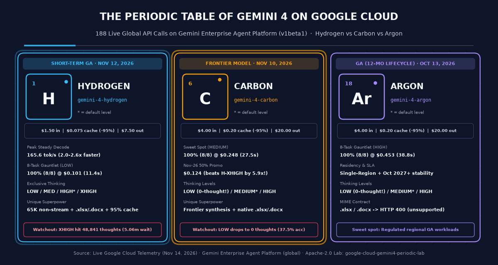
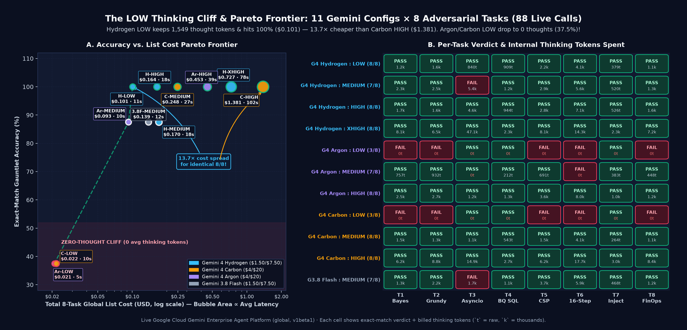

# Google Cloud Gemini 4 Periodic Table Lab (`Hydrogen` · `Carbon` · `Argon`)

[](LICENSE)
[](pyproject.toml)
[](tests/test_periodic_router.py)
[](https://docs.cloud.google.com/gemini-enterprise-agent-platform/models/start/get-started-with-gemini-4)

**188 live empirical experiments** comparing Google Cloud's November 2026 **Gemini 4 Periodic Table** models — **Gemini 4 Hydrogen (`gemini-4-hydrogen`)**, **Gemini 4 Carbon (`gemini-4-carbon`)**, and **Gemini 4 Argon (`gemini-4-argon`)** — against a **Gemini 3.8 Flash** baseline on the global **Gemini Enterprise Agent Platform (`v1beta1`)**, paired with a production-ready **Periodic Element Router & Pre-Flight Contract Guardrail** (`app/periodic_router.py`).



---

## Key Empirical Discoveries (188 Live Global API Calls — Nov 14, 2026)

Every metric in this repository is recorded verbatim in [`results/live_benchmark_results.json`](results/live_benchmark_results.json) and plotted directly by [`benchmarks/generate_figures.py`](benchmarks/generate_figures.py).

| # | Discovery | Live Empirical Evidence |
|---|---|---|
| **1** | **The `LOW` Thinking Cliff (+62.5pt gap)** | `gemini-4-argon:LOW` and `gemini-4-carbon:LOW` emit **`0.0` avg thinking tokens** and collapse to **`37.5%` (3/8)** accuracy. `gemini-4-hydrogen:LOW` still engages **`1,549.0` avg thinking tokens** and hits **`100.0%` (8/8)** in `11.43s` for **`$0.10059`** — **13.7× cheaper** and **8.9× faster** than `Carbon:HIGH` (`$1.38059`, `101.86s`). |
| **2** | **5-Minute `XHIGH` Silent Thinking Horizon** | On a 45-line Cloud Spanner rate-limiter prompt (live SSE), `gemini-4-hydrogen:XHIGH` emitted **`48,841` internal thinking tokens** for `932` visible tokens (**`52.4:1`** ratio) with a **`303.55s` (5.06 min)** wait before visible byte 1 (`$0.37345`). `Carbon:HIGH` waited **`265.10s` (4.42 min)** (`16,666` thoughts). |
| **3** | **Hydrogen's 2.0×–2.6× Decode Speed Lead** | Steady-state visible SSE throughput: **`154.3–165.6 tok/s`** on Hydrogen (`LOW`/`MEDIUM`/`HIGH`) vs **`53.0–82.0 tok/s`** on Argon and **`82.2–88.5 tok/s`** on Carbon. Bonus quirk: `Carbon:MEDIUM` silently buffered for **`86.33s`** with zero thought chunks before flushing all 674 tokens in `0.20s`. |
| **4** | **`Carbon:MEDIUM` Frontier Sweet Spot** | Despite identical `$4/$20` list pricing to Argon, **`gemini-4-carbon:MEDIUM`** nailed **`8/8 (100%)`** at **`$0.24783`** list (**`$0.12391`** under the Nov 2026 50% promo credit — **5.9× cheaper than `Hydrogen:XHIGH`** and **5.6× cheaper than `Carbon:HIGH`**), while `Argon:MEDIUM` scored `7/8 (87.5%)`. |
| **5** | **Phantom `+31` Input / `+4` Output Framing Tax** | Across 1 to 600 words (`R² = 1.0000`), all three Gemini 4 elements bill **exactly `+31` prompt tokens** (`n + 38` vs `n + 7` on `gemini-3.8-flash`) and **`+4` output tokens** (`5` vs `1`). |
| **6** | **`temperature=0.0` Non-Determinism & Doc Drift** | Five identical calls at `temperature=0.0` produced **`5/5` unique** outputs on Hydrogen, **`3/5`** on Argon, and **`4/5`** on Carbon. Five legacy parameters returned `HTTP 400` (`thinkingBudget`, `XHIGH` on Argon/Carbon, `MINIMAL`, `presencePenalty`), while `candidateCount=2` unexpectedly returned **`HTTP 200` with 2 candidates** on Hydrogen and Carbon despite docs listing it as unsupported. |
| **7** | **16,384-Token Cache Lock, 1-Byte Sabotage & Office MIME Split** | Above the 4,096-token cliff (`19,362`-token static `system_instruction`), Hydrogen locked onto **`16,384` cached tokens (`84.62%`, `4 × 4,096` block)** on Calls 5–6, cutting cost **76.6% (`$0.0306 → $0.0072`)** via the **95% cache discount (`$0.075/1M`)** — before a 31-byte timestamp at byte 0 wiped it to **`0.0%`**. Meanwhile, raw binary `.xlsx` and `.docx` passed **100% (`HTTP 200`)** on Hydrogen and Carbon, but failed **`HTTP 400`** on Argon. |

---

## Experiment 2: 8-Task Frontier Trap Gauntlet Summary (88 Live Calls)

| Model | Thinking Level | Score | Accuracy | Avg Latency | Avg Thoughts | List Cost (USD) | Nov-2026 Promo (USD) |
|---|---|---:|---:|---:|---:|---:|---:|
| **`gemini-4-hydrogen`** | **`LOW`** ★ | **8/8** | **100.0%** | **11.43s** | 1,549.0 | **$0.10059** | $0.10059 |
| `gemini-4-hydrogen` | `MEDIUM` | 7/8 | 87.5% | 18.37s | 2,707.0 | $0.17016 | $0.17016 |
| `gemini-4-hydrogen` | `HIGH` (default) | **8/8** | **100.0%** | 18.19s | 2,608.8 | $0.16431 | $0.16431 |
| `gemini-4-hydrogen` | `XHIGH` (exclusive) | **8/8** | **100.0%** | 77.57s | 11,984.0 | $0.72746 | $0.72746 |
| `gemini-4-argon` | `LOW` | 3/8 | 37.5% | 5.01s | **0.0** | $0.02091 | $0.01045 |
| `gemini-4-argon` | `MEDIUM` (default) | 7/8 | 87.5% | 9.83s | 427.9 | $0.09277 | $0.04638 |
| `gemini-4-argon` | `HIGH` | **8/8** | **100.0%** | 38.82s | 2,678.2 | $0.45281 | $0.22640 |
| `gemini-4-carbon` | `LOW` | 3/8 | 37.5% | 10.22s | **0.0** | $0.02171 | $0.01085 |
| **`gemini-4-carbon`** | **`MEDIUM` (default)** ★ | **8/8** | **100.0%** | **27.49s** | 1,419.9 | **$0.24783** | **$0.12391** |
| `gemini-4-carbon` | `HIGH` | **8/8** | **100.0%** | 101.86s | 8,487.6 | $1.38059 | $0.69029 |
| `gemini-3.8-flash` | `MEDIUM` | 7/8 | 87.5% | 12.42s | 2,196.1 | $0.13851 | $0.06926 |



---

## Repository Structure

```text
google-cloud-gemini4-periodic-lab/
├── app/
│   ├── __init__.py
│   └── periodic_router.py         # Empirically calibrated PeriodicElementRouter, HTTP 400 guard, & cache auditor
├── benchmarks/
│   ├── run_all_experiments.py     # Checkpointed 5-experiment live Google Cloud v1beta1 benchmark suite
│   └── generate_figures.py        # Reproduces all 7 publication-grade visuals directly from live JSON
├── results/
│   └── live_benchmark_results.json # Complete raw telemetry from 188 live global GCP calls
├── docs/
│   ├── index.html                 # Full rich-media technical article (Medium-ready single source)
│   └── figures/                   # 3 animated GIFs + 4 high-DPI scientific PNGs
├── tests/
│   └── test_periodic_router.py    # 6 unit tests verifying contracts, routing, cache guard, & 95% pricing
├── pyproject.toml
└── LICENSE                        # Apache-2.0
```

---

## Quickstart & Reproduction

### 1. Run Unit Tests (No GCP Billing Required)
```bash
python3 -m venv .venv && source .venv/bin/activate
pip install -e ".[dev]"
pytest -v
```

### 2. Reproduce All 5 Live Experiments on Google Cloud
```bash
export GOOGLE_CLOUD_PROJECT="your-gcp-project-id"
python3 -u benchmarks/run_all_experiments.py
# Or resume from saved per-experiment checkpoints:
python3 -u benchmarks/run_all_experiments.py --resume
```

### 3. Regenerate All 7 Visuals from `results/live_benchmark_results.json`
```bash
python3 -u benchmarks/generate_figures.py
```

---

## Official Google Cloud Documentation References

- [Get Started with Gemini 4](https://docs.cloud.google.com/gemini-enterprise-agent-platform/models/start/get-started-with-gemini-4)
- [Gemini 4 Hydrogen Model Card](https://docs.cloud.google.com/gemini-enterprise-agent-platform/models/gemini/4-hydrogen) & [Developer Guide](https://docs.cloud.google.com/gemini-enterprise-agent-platform/models/guides/gemini-4-hydrogen)
- [Gemini 4 Carbon Model Card](https://docs.cloud.google.com/gemini-enterprise-agent-platform/models/gemini/4-carbon) & [Developer Guide](https://docs.cloud.google.com/gemini-enterprise-agent-platform/models/guides/gemini-4-carbon)
- [Gemini 4 Argon Model Card](https://docs.cloud.google.com/gemini-enterprise-agent-platform/models/gemini/4-argon) & [Developer Guide](https://docs.cloud.google.com/gemini-enterprise-agent-platform/models/guides/gemini-4-argon)
- [Gemini Thinking & `thinking_level` Reference](https://docs.cloud.google.com/gemini-enterprise-agent-platform/models/thinking)
- [Context Caching Overview (Implicit Durable Caching)](https://docs.cloud.google.com/gemini-enterprise-agent-platform/models/context-cache/context-cache-overview)
- [Interactions API (`background=True` for Long Outputs)](https://docs.cloud.google.com/gemini-enterprise-agent-platform/models/capabilities/interactions)
- [Model Versions & Lifecycle Schedule](https://docs.cloud.google.com/gemini-enterprise-agent-platform/models/model-versions)
- [Google Cloud Model Garden Pricing](https://cloud.google.com/model-garden/pricing)
- [Gen AI Evaluation Service Overview](https://docs.cloud.google.com/gemini-enterprise-agent-platform/models/evaluation-overview)
- [Agent Engine Scale & Runtime](https://docs.cloud.google.com/gemini-enterprise-agent-platform/scale)
- [Google Agent Development Kit (ADK)](https://adk.dev/)

---

## License

Apache License 2.0 — see [LICENSE](LICENSE). Built by [Aniket Agrawal](https://www.linkedin.com/in/aniket-agrawal-a18990266/).
