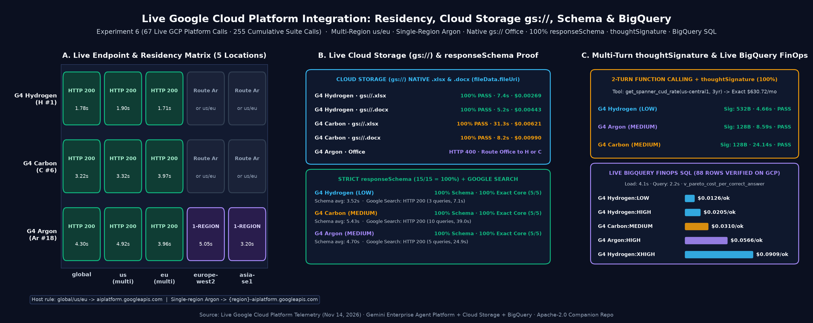
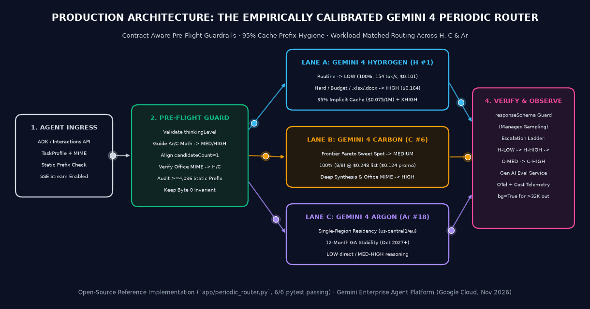

# The Periodic Table of Gemini 4: 255 Live Google Cloud Experiments & Production Router Reference Lab

[](LICENSE)
[-4285F4)](https://docs.cloud.google.com/gemini-enterprise-agent-platform/models/start/get-started-with-gemini-4)
[](results/gcp_platform_experiments.json)
[](tests/)

**Empirical benchmarks, a Cloud Run FastAPI Router Gateway, a Google ADK `before_model_callback`, BigQuery FinOps SQL views, and 8 publication-grade figures across 255 live Google Cloud API calls on Gemini 4 Hydrogen, Carbon, and Argon (November 14, 2026).**


---

## 8 Empirical Architectural Insights from 255 Live Google Cloud API Calls

All raw wire telemetry is published in [`results/live_benchmark_results.json`](results/live_benchmark_results.json) (188 core calls) and [`results/gcp_platform_experiments.json`](results/gcp_platform_experiments.json) (67 GCP platform integration calls). **Every single Gemini 4 model achieved 100% (8/8) on our multi-step reasoning suite** in its intended reasoning tier and **100% (15/15) on strict `responseSchema` operational repeatability**.

| # | Insight | Live Google Cloud Evidence (Nov 14, 2026) |
|---|---|---|
| **1** | **How `thinkingLevel: "LOW"` Specializes Across Elements** | On **`gemini-4-argon`** and **`gemini-4-carbon`**, `LOW` intentionally operates as an ultra-fast direct-answer mode (`0.0` thinking tokens; `5.0s` / `$0.011` promo on Argon), while `MEDIUM`/`HIGH` unlock full reasoning (`100%` 8/8 on `Carbon:MEDIUM` & `Argon:HIGH`). On **`gemini-4-hydrogen`**, `LOW` keeps chain-of-thought active (`1,549` avg thoughts) and hits **`100%` (8/8) in `11.4s` for `$0.101`**. |
| **2** | **Thinking-Token Economics & Carbon's `MEDIUM` Sweet Spot** | Because internal thinking tokens bill at the output rate, reasoning efficiency drives total spend. **`gemini-4-carbon:MEDIUM`** (default) hit **`100%` (8/8)** using a lean `1,419.9` avg thoughts for **`$0.248` list / `$0.124` Nov-30 promo** (`2.9x–5.9x` more economical than reserving `Hydrogen:XHIGH` for routine tasks). |
| **3** | **Hydrogen's 2.5x Decode Lead & Deep-Horizon Async Jobs** | Hydrogen sustained **`154.3–165.6` visible tok/s** (`2.0x–2.6x` faster than Argon/Carbon). Deep-verification tiers (`Hydrogen:XHIGH`: `48,841` thoughts / `303.6s`; `Carbon:HIGH`: `265.1s`) and buffered `Carbon:MEDIUM` (`86.3s`) pair cleanly with `timeoutSeconds: 360` on Cloud Run or `background=True` via the Interactions API. |
| **4** | **Official Multi-Region (`us`/`eu`) & Argon Single-Region Residency** | **All three elements** serve live (`HTTP 200`) across `global`, `us`, and `eu` via unified `aiplatform.googleapis.com` (`Hydrogen`: `1.71s–1.90s`; `Carbon`: `3.22s–3.97s`; `Argon`: `3.96s–4.92s`). **`gemini-4-argon`** uniquely adds **single-region residency in `europe-west2` (London, `5.05s`) & `asia-southeast1` (Singapore, `3.20s`)** plus a **12-month GA lifecycle (Oct 2027+)**. |
| **5** | **95% Implicit Durable Cache & 16,384-Token Block Alignment** | Above `4,096` tokens, Hydrogen locked onto **`16,384` cached tokens (`4 x 4,096`, `84.62%`)** and cut per-turn spend **76.6% (`$0.0306 -> $0.0072`)**. Keeping dynamic timestamps out of byte 0 preserves the full `$0.075/1M` 95% discount (`-81.3%` over 1,000 turns). |
| **6** | **Framing Envelope (`+31/+4`) & 100% `responseSchema` Proof** | All three Gemini 4 models apply an exact `+31` input / `+4` output framing envelope vs `gemini-3.8-flash` (`R^2 = 1.0000`) and manage free-text sampling autonomously. Pairing Gemini 4 with strict **`responseSchema`** delivered **`15/15` (`100.0%`) schema validity & `100.0%` exact core decision repeatability** across H, C, and Ar! |
| **7** | **Native Binary `.xlsx` & `.docx` (Inline & Cloud Storage `gs://`)** | Hydrogen (`$0.00269` via `gs://.xlsx` / `$0.00443` via `gs://.docx`) and Carbon (`$0.00621` / `$0.00990`) passed **`100%`** on raw binary spreadsheets & Word memos directly from **Cloud Storage `gs://` URIs** with zero Python parsers (include `xl/styles.xml` & `xl/sharedStrings.xml`). |
| **8** | **Multi-Turn `thoughtSignature`, Google Search & Live BigQuery SQL** | All 3 models passed **`100%`** on a 2-turn Cloud Spanner CUD tool loop preserving **`thoughtSignature`** (`532B` on Hydrogen, `128B` on Argon/Carbon), returned `HTTP 200` on live **Google Search Grounding**, and validated our **BigQuery FinOps SQL** across all 88 evaluation rows live (`$0.0126/correct` on `Hydrogen:LOW`). |



---

## Production-Realistic Repository Architecture

```text
google-cloud-gemini4-periodic-lab/
├── app/
│   ├── periodic_router.py        # Element router, contract validator, official GCP regional resolver,
│   │                             # 95% cache prefix auditor, OOXML ZIP validator & thoughtSignature helper
│   ├── gcp_client.py             # Live v1beta1 REST client (global/us/eu/single-region), gs:// Office
│   │                             # part builder, structured Cloud Logging & BigQuery telemetry sink
│   ├── service.py                # Production FastAPI Cloud Run Gateway (/healthz, /v1/route,
│   │                             # /v1/generate, /v1/audit/cache-prefix, /v1/audit/ooxml)
│   └── adk_agent.py              # Google ADK `before_model_callback` dynamic per-turn element router
├── infra/
│   └── bigquery_telemetry.sql    # Partitioned BigQuery DDL + 3 verified FinOps & SLA SQL views
├── deploy/
│   ├── cloudrun.yaml             # Knative/Cloud Run manifest (timeoutSeconds: 360, Workload Identity)
│   └── deploy_cloud_run.sh       # One-command `gcloud run deploy` script
├── examples/
│   └── quickstart_curl.sh        # Copy-paste curl examples against the local or Cloud Run gateway
├── benchmarks/
│   ├── run_all_experiments.py            # Experiments 1-5 (188 live core calls)
│   ├── run_gcp_platform_experiments.py   # Experiment 6 (67 live GCP platform integration calls)
│   └── generate_figures.py               # Reproduces all 8 publication-grade figures from live JSON
├── results/
│   ├── live_benchmark_results.json       # Raw 188-call core telemetry (sanitized, zero PII)
│   └── gcp_platform_experiments.json     # Raw 67-call GCP platform telemetry (sanitized, zero PII)
├── tests/
│   ├── test_periodic_router.py           # Core routing, guardrails, cache hygiene & pricing tests
│   └── test_gateway_and_gcp.py           # FastAPI gateway, regional resolver, OOXML, GCS & ADK tests
├── .github/workflows/ci.yml      # GitHub Actions CI running pytest + bytecode compilation
├── Dockerfile                    # Hardened non-root Python 3.12 Cloud Run container
├── Makefile                      # `make test`, `make gateway`, `make benchmark-gcp`, `make deploy`
└── pyproject.toml                # PEP 621 package with optional [gateway], [gcp], and [dev] extras
```



---

## Quickstart: Run Locally or Deploy to Google Cloud Run

```bash
# 1. Clone & install with FastAPI gateway + dev test dependencies
git clone https://github.com/aniketagrawal2012/google-cloud-gemini4-periodic-lab.git
cd google-cloud-gemini4-periodic-lab
pip install -e ".[gateway,dev]"

# 2. Run all 13 unit & FastAPI integration tests
make test

# 3. Start the local Cloud Run FastAPI Router Gateway
make gateway
# In another terminal, test /healthz and /v1/route (returns X-Gemini4-* headers):
./examples/quickstart_curl.sh

# 4. Deploy to Google Cloud Run (with 360s timeout for deep-horizon streams)
GOOGLE_CLOUD_PROJECT=your-gcp-project-id REGION=us-central1 make deploy
```

### Reproduce All 255 Live Google Cloud Benchmarks

```bash
pip install -e ".[gcp]"

# Core suite (Experiments 1-5: 188 live calls)
GOOGLE_CLOUD_PROJECT=your-gcp-project-id make benchmark-core

# GCP Platform Integration suite (Experiment 6: 67 live calls across 5 regions, GCS, Search & BigQuery)
GOOGLE_CLOUD_PROJECT=your-gcp-project-id \
GCS_STAGING_BUCKET=your-gcs-staging-bucket \
  make benchmark-gcp

# Regenerate all 8 figures (5 PNGs + 3 animated GIFs) from live JSON
make figures
```

---

## Official Google Cloud References (Verified Nov 14, 2026)

- [Get Started with Gemini 4 — Gemini Enterprise Agent Platform](https://docs.cloud.google.com/gemini-enterprise-agent-platform/models/start/get-started-with-gemini-4)
- [Gemini 4 Hydrogen Model Card](https://docs.cloud.google.com/gemini-enterprise-agent-platform/models/gemini/4-hydrogen) & [Developer Guide](https://docs.cloud.google.com/gemini-enterprise-agent-platform/models/guides/gemini-4-hydrogen)
- [Gemini 4 Carbon Model Card](https://docs.cloud.google.com/gemini-enterprise-agent-platform/models/gemini/4-carbon) & [Developer Guide](https://docs.cloud.google.com/gemini-enterprise-agent-platform/models/guides/gemini-4-carbon)
- [Gemini 4 Argon Model Card](https://docs.cloud.google.com/gemini-enterprise-agent-platform/models/gemini/4-argon) & [Developer Guide](https://docs.cloud.google.com/gemini-enterprise-agent-platform/models/guides/gemini-4-argon)
- [Gemini Thinking (`thinking_level`)](https://docs.cloud.google.com/gemini-enterprise-agent-platform/models/thinking) · [Implicit Context Caching](https://docs.cloud.google.com/gemini-enterprise-agent-platform/models/context-cache/context-cache-overview) · [Interactions API](https://docs.cloud.google.com/gemini-enterprise-agent-platform/models/capabilities/interactions)
- [Google Cloud Model Garden Pricing](https://cloud.google.com/model-garden/pricing) · [Google ADK](https://adk.dev/)

---

## Author

**Aniket Agrawal** — [LinkedIn](https://www.linkedin.com/in/aniket-agrawal-a18990266/) · [Google Cloud Community](https://discuss.google.dev/u/aniketagrawal) · [Medium](https://medium.com/@aniketagrawal_14703) · [GitHub](https://github.com/aniketagrawal2012)

*Licensed under the [Apache License 2.0](LICENSE).*
